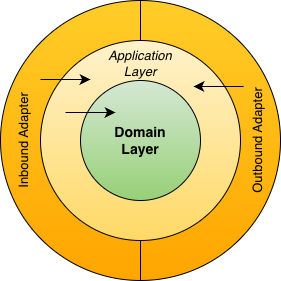

# MicroRust

> **Focus on the domain and the use cases, not on the “glue code”**

MicroRust Application Framework

A modern rust application framework, asynchronous and with batteries included.

Inspired by frameworks like Spring Boot, Micronaut and Quarkus.

> Status: POC and WIP

## Layers and Dependency Inversion



## Features
* Dependency Injection

## Inbound Adapter (Server)
- REST / JSON
- GraphQL
- gRPC
- Message Subscription
- MCP
- Traditional HTML WebApp

## Outbound Adapter (Client)
- Relational Database
- Document Database
- In-Memory Database
- Object Store
- REST / JSON
- GraphQL
- gRPC
- Message Publishing
- MCP
- IAM / IDM

## Examples

### Dependency Injection
```rust
use microrust::inject::{get_instance, singleton};

struct MyStruct {}

#[singleton(new)]
impl MyStruct {
    pub fn new() -> Self {
        println!("MyStruct::new() called");
        Self {}
    }

    async fn print(&self) {
        println!("Hello, MyStruct");
    }
}

#[tokio::main]
async fn main() {
    let inst = get_instance::<MyStruct>();
    // let inst: Arc<MyStruct> = get_instance();
    inst.print().await;
}
```
