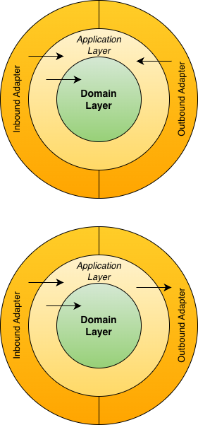

# MicroRust Dependency Injection

## Layers and Dependency Inversion

You have two ways to take advantage of dependency injection:
- Dependency inversion using *trait*
- Dependency injection using *struct* or *function*



## trait

## struct

```rust
use microrust::inject::{get_instance, singleton};

struct MyStruct {}

#[singleton(new)]
impl MyStruct {
    pub fn new() -> Self {
        println!("MyStruct::new() called");
        Self {}
    }

    async fn print(&self) {
        println!("Hello, MyStruct");
    }
}

#[microrust::main]
async fn main() {
    let inst = get_instance::<MyStruct>();
    // let inst: Arc<MyStruct> = get_instance();
    inst.print().await;
}
```

## function
